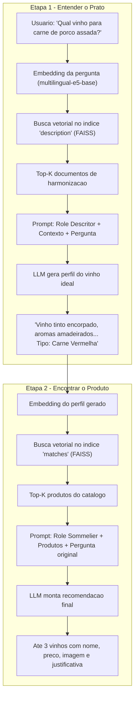

# Wine Sommelier AI


Sommelier virtual com inteligencia artificial. Descreva seu prato e receba recomendacoes de vinhos personalizadas com nome, preco, imagem e justificativa de harmonizacao.

## Sobre o Projeto

O Wine Sommelier AI utiliza **RAG (Retrieval-Augmented Generation)** em dois estagios para recomendar vinhos. O sistema nao e uma simples busca por palavras-chave -- ele *raciocina* sobre o prato do usuario, primeiro entendendo que tipo de vinho seria ideal, e so depois procurando produtos reais que correspondam a esse perfil.

O sistema suporta tanto LLMs locais via **Ollama** quanto a **API da Mistral** na nuvem.

## Como o Sistema Pensa

O processo interno segue uma cadeia de raciocinio em dois estagios, cada um com seu proprio indice vetorial, role de prompt e chamada a LLM.



### Etapa 1 -- O Descritor: "Que tipo de vinho combina?"

Quando o usuario digita um prato, a primeira coisa que o sistema faz **nao** e procurar vinhos. Ele primeiro precisa entender *que tipo de vinho* seria adequado.

1. A pergunta do usuario e convertida em um vetor numerico pelo modelo de embeddings `intfloat/multilingual-e5-base` (multilingual, otimizado para busca semantica).
2. Esse vetor e comparado contra o indice FAISS `description`, que contem conhecimento de harmonizacao extraido de PDFs e documentos sobre enologia. O FAISS retorna os **Top-K documentos mais semanticamente proximos** da pergunta.
3. Esses documentos sao concatenados e injetados como contexto em um prompt estruturado. A LLM recebe a **role de Descritor** -- um sommelier que deve apenas descrever o perfil do vinho ideal (tipo, cor, aroma, corpo, acidez) e classificar a categoria do prato (carne vermelha, frutos do mar, vegetariano, etc.).
4. A resposta e truncada em 200 caracteres para mante-la concisa e focada -- ela serve como uma *query intermediaria*, nao como resposta final.

**Exemplo de saida da Etapa 1:**
> "Vinho tinto encorpado, aromas amadeirados, para acompanhar carne vermelha, Tipo: Carne Vermelha"

### Etapa 2 -- O Sommelier: "Qual vinho especifico recomendar?"

Agora o sistema tem um perfil abstrato do vinho ideal. Esse perfil vira a nova query de busca.

1. O perfil gerado na Etapa 1 e convertido em vetor e buscado contra o indice FAISS `matches`, que contem o **catalogo real de produtos** (nome, descricao, preco, imagem, notas de harmonizacao).
2. Os Top-K produtos mais similares ao perfil sao recuperados.
3. Esses produtos sao injetados como contexto em um novo prompt, agora com a **role de Sommelier** -- um profissional de restaurante 5 estrelas que fala diretamente com o cliente, explicando *por que* cada vinho combina com o prato, de forma educada e profissional.
4. A LLM gera a resposta final em Markdown/HTML com ate 3 vinhos, cada um com imagem, nome, preco e justificativa de harmonizacao.

### Por que dois estagios?

Uma busca direta de "carne de porco assada" no catalogo de vinhos dificilmente traria resultados relevantes -- os produtos nao mencionam pratos, e sim caracteristicas do vinho. O primeiro estagio faz a **traducao semantica** do dominio do prato para o dominio do vinho, permitindo que a segunda busca encontre produtos por similaridade de perfil enologico.

### Embeddings e Busca Vetorial

O modelo `intfloat/multilingual-e5-base` converte textos em vetores de 768 dimensoes. A busca no FAISS calcula a distancia entre o vetor da query e todos os vetores do indice, retornando os K mais proximos. Como o modelo e multilingual, ele entende tanto portugues quanto termos tecnicos de enologia em outros idiomas.

### Estrutura dos Prompts

Cada prompt segue o formato:

```
<role> ... instrucoes do papel (descritor ou sommelier) ... </role>
<contexto> ... documentos recuperados do FAISS ... </contexto>
<pergunta> ... pergunta original do usuario ... </pergunta>
<resposta> ...
```

Isso garante que a LLM nao invente informacoes -- ela so pode usar o contexto fornecido pelo retriever, o que reduz alucinacoes e mantem as recomendacoes ancoradas em dados reais.

## Tech Stack

| Categoria | Tecnologias |
|---|---|
| Linguagem | Python 3.12+ |
| Interface | Streamlit |
| Framework RAG | LangChain |
| Busca Vetorial | FAISS (`faiss-cpu`) |
| Embeddings | HuggingFace (`intfloat/multilingual-e5-base`) |
| LLM | Ollama (local) / Mistral API (nuvem) |
| Processamento de PDFs | pdf2image, PyMuPDF, PyPDF, PDFPlumber, Pytesseract |
| OCR | Tesseract |

## Estrutura do Projeto

```
Wine-Sommelier-AI/
├── web/
│   ├── streamlit_app.py        # Aplicacao Streamlit (entry point)
│   └── rag_core.py             # Logica RAG, vetores, prompts e LLM
├── data/
│   ├── vinhos_completos.csv    # Catalogo de vinhos (nome, descricao, preco, imagem)
│   └── vinicola_goes_vinhos.csv# Catalogo detalhado com info de harmonizacao
├── faiss/
│   ├── description/            # Indice FAISS de conhecimento de harmonizacao
│   └── matches/                # Indice FAISS de produtos
├── WINE.ipynb                  # Notebook para gerar os indices FAISS
├── pyproject.toml              # Dependencias do projeto
├── poppler/                    # Binarios do Poppler (Windows)
└── Tesseract-OCR/              # Binarios do Tesseract (Windows)
```

## Pre-requisitos

- **Python 3.12** ou superior
- **Ollama** instalado e rodando (para LLM local) **ou** uma chave de API da **Mistral**
- **Poppler** e **Tesseract OCR** (binarios incluidos no repositorio para Windows)

## Instalacao

1. Clone o repositorio:

```bash
git clone https://github.com/seu-usuario/Wine-Sommelier-AI.git
cd Wine-Sommelier-AI
```

2. Instale as dependencias com **uv** (recomendado):

```bash
uv sync
```

Ou com pip:

```bash
pip install -e .
```

3. Gere os indices FAISS (caso a pasta `faiss/` esteja vazia):

- Abra e execute o notebook `WINE.ipynb`
- Ele processa PDFs e CSVs da pasta `data/` e cria os indices em `faiss/description/` e `faiss/matches/`

## Como Usar

Inicie a aplicacao:

```bash
streamlit run web/streamlit_app.py
```

Na interface:

1. Digite a descricao do prato no campo de texto (ex: *"Qual vinho combinar com carne de porco assada?"*)
2. Clique em **Executar**
3. Aguarde a recomendacao com ate 3 vinhos

### Opcoes da Sidebar

| Opcao | Descricao |
|---|---|
| **Modelo** | Nome do modelo LLM (`mistral-small-latest` para API, `mistral:instruct` para Ollama) |
| **MISTRAL_API_KEY** | Chave da API Mistral (obrigatoria para uso na nuvem) |
| **Top-K contexto** | Quantidade de documentos de harmonizacao recuperados (padrao: 3) |
| **Top-K produtos** | Quantidade de vinhos retornados na recomendacao (padrao: 3) |
| **Modo debug** | Exibe documentos recuperados, prompts e respostas intermediarias |

## Configuracao

### Variavel de Ambiente

| Variavel | Obrigatoria | Descricao |
|---|---|---|
| `MISTRAL_API_KEY` | Sim (API Mistral) | Chave de acesso da API Mistral. Pode ser informada via sidebar ou variavel de ambiente. |

### LLM Local (Ollama)

Para usar o Ollama como backend local, instale-o e inicie o servico:

```bash
ollama pull mistral:instruct
```

O modelo sera baixado automaticamente na primeira execucao caso nao esteja disponivel.

## Licenca

Este projeto ainda nao possui uma licenca definida.
